  

# 🌐 Awesome 3D Procedural Generation & WebGL Ecosystem 🎮

  
  
  
  
  

---

## 🧭 Overview & Introduction

A curated index of **SaaS platforms**, **cloud studios**, and **open-source developer libraries** dedicated to **3D Procedural Generation, WebGL, and WebGPU graphics**. 

Whether you are synthesizing infinite procedural terrains, solving constraint-based **Wave Function Collapse (WFC)** dungeon grids, generating rule-based architectural facades, or compiling parametric **CSG/B-Rep CAD geometry** straight in the browser, this collection provides the leading industry platforms, algorithmic foundations, and WebAssembly-accelerated math kernels.

### 🎯 Key Domains Covered
- 🎲 **Wave Function Collapse & Constraint Solvers**: Model synthesis, tile solvers, and stochastic procedural dungeons.
- 🏙️ **Procedural Architecture & City Synthesizers**: Shape grammars (CGA), parcel subdivisions, road graphs, and parametric building extrusions.
- ⛰️ **Algorithmic Terrains & Noise Functions**: Perlin/Simplex noise, erosion simulations, Marching Cubes, and isosurface extraction.
- 📐 **Parametric CAD & Solid Geometry (CSG)**: Constructive Solid Geometry, B-Rep modeling, Manifold WASM booleans, and FeatureScript.
- ⚡ **Real-Time WebGL/WebGPU Engines**: Spatial BVH acceleration, instanced mesh rendering (`InstancedMesh`), shader nodes, and WebXR.

---

## 📊 Sector Overview & Market Dynamics

- **Market Size**: The global **3D mapping, modeling, and procedural graphics software** market was estimated between **$7.6B and $12.6B in 2025–2026**, on track to expand past **$24B–$45B by the mid-2030s** at an estimated **13.5%–17.3% CAGR**. In tandem, the **generative 3D AI and automated 3D asset generation** sub-sector is rapidly accelerating from **~$1.6B** toward **$9.4B+ by 2032** (~30%–39% CAGR).
- **Market Dynamics & Fragmentation**: The market exhibits a **moderately fragmented and bifurcated structure** rather than a winner-take-all monopoly. Enterprise engineering and spatial GIS are concentrated around incumbent giants (such as **Autodesk**, **PTC**, and **Esri**), while the browser-first procedural design, creative game development, and WebGL/WebGPU ecosystem remain highly fragmented with rapid innovation from agile venture-backed startups (e.g., **Spline**, **Vectary**, **Luma AI**, **Meshy**) and dominant open-source foundational libraries (**Three.js**, **Godot**, **Blender**).

---

## 📑 Table of Contents

- [📊 Sector Overview & Market Dynamics](#-sector-overview--market-dynamics)
- [☁️ SaaS & Hosted 3D Platforms](#️-saas--hosted-3d-platforms)
- [🔓 Open-Source GitHub Projects](#-open-source-github-projects)
- [🌟 Star History](#-star-history)
- [💖 Support & Sponsorship](#-support--sponsorship)
- [🤝 How to Contribute](#-how-to-contribute)
- [📜 Disclaimer & Guidelines](#-disclaimer--guidelines)

---

## ☁️ SaaS & Hosted 3D Platforms

The table below lists leading SaaS and cloud-hosted platforms supporting 3D procedural modeling, scene synthesis, parametric pipelines, and interactive WebGL exports, sorted by company scale (valuation / market capitalization / revenue descending).

| Platform | Focus & Procedural Capabilities | Company Scale / Valuation | Pricing (Starting Paid Tier) | Free Tier / Evaluation Limits |
| :--- | :--- | :--- | :--- | :--- |
| **[Autodesk Tinkercad](https://www.tinkercad.com)** | Browser-based CSG modeling, procedural visual Codeblocks, and educational 3D simulation. | **~$55B Market Cap** (~$7.2B annual revenue) | **100% Free** ($0 commercial & educational use) | **Unlimited free access forever** (no locked features, basic web export caps) |
| **[Epic Games / Sketchfab](https://sketchfab.com)** | WebGL 3D model publishing, real-time procedural scene inspection, and interactive embeds. | **~$22.5B Valuation** (Sketchfab acquired ~$100M+) | **$15/mo** (Pro Plan, billed annually) | **Basic Plan Free Forever**: Max 100 MB per file, public models only, up to 5 annotations per model |
| **[PTC Onshape](https://www.onshape.com)** | Cloud-native parametric CAD with FeatureScript procedural geometry scripting language. | **~$21B Market Cap** (~$2.7B annual revenue) | **$1,500/user/year** (~$125/user/month, Standard Plan) | **Free Plan Forever**: Strictly public documents only (all data searchable/public), non-commercial use only, 100 MB private workspace |
| **[Snap PlayCanvas](https://playcanvas.com)** | Collaborative cloud WebGL2/WebGPU game engine with procedural mesh creation APIs. | **~$9.5B Market Cap** (Snap subsidiary) | **$15/user/month** (Personal Plan) | **Free Plan Forever**: 1 GB storage, unlimited public projects, free web hosting; private projects & self-hosting disabled |
| **[Esri ArcGIS CityEngine](https://www.esri.com/en-us/arcgis/products/arcgis-cityengine/overview)** | Enterprise urban procedural modeling using Computer Generated Architecture (CGA) shape grammars. | **~$1.3B+ Annual Revenue** (Privately held GIS leader) | **$2,000/user/year** (Commercial Term License) | **21-Day Free Trial**: Full functional evaluation access with export capabilities for 21 days |
| **[Spline](https://spline.design)** | Collaborative WebGL design studio with procedural cloner modifiers, physics, and React exports. | **~$75M Valuation** ($25M funding, ~$5M ARR) | **$12/month** (Hobby Plan, billed annually; or $15/mo monthly) | **Free Plan Forever**: Unlimited viewers, personal files, library templates; web exports include Spline watermark, 0 AI credits |
| **[Vectary](https://www.vectary.com)** | Parametric 3D web studio with non-destructive procedural modifiers, material graphs, and WebAR. | **~$35M Valuation** ($14M funding, ~$4M ARR) | **$25/month** (Starter Plan, monthly) | **Free Plan Forever**: Up to 5 active workspace projects, 1 user seat, full Studio & Canvas tools included |
| **[Meshy 3D](https://www.meshy.ai)** | AI-driven procedural 3D mesh and texture synthesis with automated topology generation. | **Seed-stage VC backed** (~$5M+ raised) | **$20/month** (Pro Plan) | **Free Plan Forever**: 100 credits/mo, up to 10 downloads/mo (Meshy 6 Lite untextured meshes only, CC BY 4.0 attribution required) |
| **[Sloyd 3D](https://www.sloyd.ai)** | Algorithmic and generative SDK for procedural 3D game asset creation and real-time tweaking. | **Seed-stage VC backed** (~$3M+ raised) | **$15/month** ($12.50/mo billed annually, Plus Plan) | **Guest Plan Free Forever**: 1 generation/day, browser template editor access, GLB/OBJ export, personal non-commercial use only |
| **[BiteTheBytes World Creator](https://www.world-creator.com)** | Real-time GPU procedural landscape, mountain, and heightmap generation with web/engine bridges. | **Bootstrapped / Indie profitable studio** | **$42 one-time** (Individual license under $200k rev) | **Frozen Perpetual Version**: Includes 12 months updates; perpetual right to keep last downloaded version forever |

---

## 🔓 Open-Source GitHub Projects

The following curated open-source repositories provide the building blocks for procedural 3D meshes, constraint solvers, noise algorithms, and WebGL/WebGPU graphics. 

Repositories are sorted by **GitHub Star Count (descending)**. Every repository title includes a social star badge linking directly to its stargazer community.

---

### 1. [godotengine/godot](https://github.com/godotengine/godot) 
> **License:** `MIT` | **Focus:** Multi-platform 2D and 3D game engine  
> Features full runtime procedural geometry generation (`ArrayMesh`, `SurfaceTool`, and `ImmediateMesh`) with modern WebAssembly, WebGL2, and WebGPU deployment pipelines.

### 2. [mrdoob/three.js](https://github.com/mrdoob/three.js) 
> **License:** `MIT` | **Focus:** Foundational JavaScript 3D WebGL/WebGPU library  
> The standard backbone for browser 3D. Supports parametric geometry primitives, `InstancedMesh` for rendering millions of procedural parts at 60 fps, WebGPU TSL (Three Shading Language), and browser scene inspection.

### 3. [bevyengine/bevy](https://github.com/bevyengine/bevy) 
> **License:** `MIT` / `Apache-2.0` | **Focus:** Refreshingly simple data-driven game engine built in Rust  
> Highly popular for procedural world-building thanks to its cache-friendly ECS architecture, deterministic multi-threading, and high-performance WebAssembly/WebGPU rendering.

### 4. [BabylonJS/Babylon.js](https://github.com/BabylonJS/Babylon.js) 
> **License:** `Apache-2.0` | **Focus:** Complete WebGL and WebGPU 3D game and app framework  
> Includes a built-in visual **Node Geometry Editor (NGE)** allowing developers to graphically construct complex procedural meshes, scatter transforms, and parametric surfaces directly in the browser.

### 5. [mxgmn/WaveFunctionCollapse](https://github.com/mxgmn/WaveFunctionCollapse) 
> **License:** `MIT` | **Focus:** Constraint-based bitmap and tile procedural generation  
> The seminal implementation of the Wave Function Collapse algorithm. Inspired by quantum collapse and texture synthesis, it forms the foundation of modern procedural 3D modular dungeons, city blocks, and architectural layouts.

### 6. [blender/blender](https://github.com/blender/blender) 
> **License:** `GPL-2.0+` | **Focus:** Open-source 3D creation suite  
> Features the industry-standard **Geometry Nodes** system for non-destructive procedural terrain, vegetation distribution, building extrusion, and parametric asset compilation with glTF/GLB web export.

### 7. [openscad/openscad](https://github.com/openscad/openscad) 
> **License:** `GPL-2.0+` | **Focus:** The programmers' solid 3D CAD compiler  
> Compiles declarative CSG script code into deterministic 3D solid meshes. Widely adapted into WebAssembly for client-side procedural geometry compilation in browser viewports.

### 8. [mxgmn/MarkovJunior](https://github.com/mxgmn/MarkovJunior) 
> **License:** `MIT` | **Focus:** Probabilistic programming language for procedural generation  
> Developed by the author of WFC, MarkovJunior uses constraint rewriting rules based on Markov algorithms to generate organic 3D voxel houses, dungeons, paths, and labyrinth architectures.

### 9. [princeton-vl/Infinigen](https://github.com/princeton-vl/Infinigen) 
> **License:** `BSD-3-Clause` | **Focus:** Infinite photorealistic 3D world generator (Princeton Vision & Learning Lab)  
> Procedurally synthesizes complete natural worlds—from terrain, plants, and trees to indoor structures and materials—entirely from procedural mathematical rules and geometry nodes without external scans.

### 10. [CadQuery/cadquery](https://github.com/CadQuery/cadquery) 
> **License:** `Apache-2.0` | **Focus:** Python parametric B-Rep CAD scripting framework  
> Built on the OpenCASCADE technology kernel, CadQuery enables programmatic procedural construction of complex mechanical, engineering, and architectural geometries that compile to standard STEP, STL, and glTF models.

### 11. [gkjohnson/three-mesh-bvh](https://github.com/gkjohnson/three-mesh-bvh) 
> **License:** `MIT` | **Focus:** Fast Bounding Volume Hierarchy (BVH) for Three.js  
> Drastically speeds up raycasting, point-projection, collision detection, and spatial queries against dense procedural 3D meshes in WebGL applications.

### 12. [Auburn/FastNoiseLite](https://github.com/Auburn/FastNoiseLite) 
> **License:** `MIT` | **Focus:** Extremely fast portable procedural noise library  
> Supports Simplex, OpenSimplex2, Perlin, Cellular/Voronoi, Value noise, and Domain Warping across multiple languages (C++, C#, TypeScript, JavaScript, Rust, HLSL/GLSL), ideal for procedural terrains and shaders.

### 13. [jscad/OpenJSCAD.org](https://github.com/jscad/OpenJSCAD.org) 
> **License:** `MIT` | **Focus:** JavaScript & WebGL programmatic 3D CAD framework  
> Enables modular JavaScript and browser-native CSG boolean modeling with real-time WebGL viewports, parametric sliders, and multi-format 3D export.

### 14. [ashima/webgl-noise](https://github.com/ashima/webgl-noise) 
> **License:** `MIT` | **Focus:** GLSL procedural noise functions for WebGL shaders  
> Standard library of GPU-computed Perlin, Simplex, and periodic noise functions that run inside browser fragment and vertex shaders without requiring texture lookups.

### 15. [elalish/manifold](https://github.com/elalish/manifold) 
> **License:** `Apache-2.0` | **Focus:** Ultra-fast, guaranteed-manifold 3D boolean CSG library  
> Written in C++ and compiled to WebAssembly (WASM), Manifold performs union, intersection, and difference operations orders of magnitude faster than legacy engines while guaranteeing watertight geometry.

### 16. [dgreenheck/ez-tree](https://github.com/dgreenheck/ez-tree) 
> **License:** `MIT` | **Focus:** Procedural 3D tree and foliage generator for Three.js  
> Interactive WebGL studio and library utilizing recursive branching rules, customizable trunks, leaf scattering, and instant `.glb` export for game worlds.

### 17. [felixpalmer/procedural-gl-js](https://github.com/felixpalmer/procedural-gl-js) 
> **License:** `MIT` | **Focus:** WebGL library for photorealistic procedural 3D terrain rendering  
> Integrates global digital elevation models (DEM) and satellite imagery to render smooth interactive 3D terrain maps with customizable fog, lighting, and camera flyovers.

### 18. [gkjohnson/three-bvh-csg](https://github.com/gkjohnson/three-bvh-csg) 
> **License:** `MIT` | **Focus:** High-performance procedural CSG boolean operations for Three.js  
> Uses spatial BVH trees to provide fast constructive solid geometry booleans directly inside Three.js scenes, preserving UV coordinates, vertex groups, and normals.

### 19. [IceCreamYou/THREE.Terrain](https://github.com/IceCreamYou/THREE.Terrain) 
> **License:** `MIT` | **Focus:** Procedural 3D terrain generation library for Three.js  
> Supports procedural heightmaps, diamond-square algorithms, hydraulic and thermal erosion simulations, custom smoothing filters, and asset scattering.

### 20. [mikolalysenko/isosurface](https://github.com/mikolalysenko/isosurface) 
> **License:** `MIT` | **Focus:** Real-time 3D isosurface polygonal extraction in JavaScript  
> Implements Marching Cubes and Surface Nets to generate 3D polygon meshes from volumetric procedural density fields and scalar noise fields in WebGL.

### 21. [achrefelouafi/proceduralbuildingsthreejs](https://github.com/achrefelouafi/proceduralbuildingsthreejs) 
> **License:** `MIT` | **Focus:** Procedural 3D building and city block generation for Three.js  
> Generates architectural skyscrapers, facades, multi-tiered roofs, windows, and modular building structures dynamically inside the browser with WebGL.

---

## 🌟 Star History

---

## 💖 Support & Sponsorship

If you find this procedural generation repository helpful for your games, creative coding projects, or 3D web applications, please consider supporting its ongoing curation and research:

- ⭐ **Star this repository** to help others discover it across GitHub.
- 🍴 **Fork the repo** to add your own procedural tools and experiments.
- 📣 **Share on Twitter/X, Discord, or LinkedIn** with your game dev and 3D web communities.
- ☕ **Buy me a coffee & become a sponsor**: Support ongoing open-source curation on the [GitHub Sponsor Dashboard](https://github.com/sponsors/ishandutta2007).

---

## 🤝 How to Contribute

We welcome additions of both innovative open-source projects and industry-grade SaaS platforms!

1. **Fork this repository**.
2. **Add your entry** under the appropriate category (`SaaS/Hosted Platforms` or `Open-Source GitHub Projects`).
   - For **SaaS**: Ensure exact pricing and free tier/evaluation limits are listed.
   - For **Open-Source**: Ensure full repo path and proper Markdown structure are included.
3. Keep descriptions factual, concise, and focused on **3D procedural generation & WebGL/WebGPU capabilities**.
4. Check that formatting passes linting and submit a **Pull Request**.

---

## 📜 Disclaimer & Guidelines

- This repository is a curated community directory for educational, architectural, and developer reference.
- When generating massive procedural worlds, high-density Marching Cubes voxel grids, or infinite urban metropolises in browsers, always leverage **Web Workers**, **`InstancedMesh`**, and **LOD (Level of Detail) culling** to prevent UI thread lockups and sustain steady 60 fps rendering.
- Always review open-source licenses (`MIT`, `Apache-2.0`, `BSD-3-Clause`, `GPL-2.0+`) prior to integrating libraries into commercial software.

---

  <b>Curated with ❤️ by <a href="https://github.com/ishandutta2007">Ishan Dutta</a> and the 3D WebGL community.</b>

